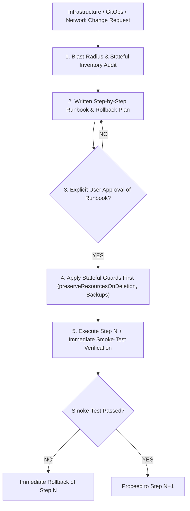

# Production Change Impact Analysis & Staged Migration Protocol

Any change touching **cluster topology, GitOps ownership (`ApplicationSet` / `AppProject`), ingress routing (`IngressRoute` / `EntryPoint` / LoadBalancer), RBAC, CNI / admission policies (Kyverno / Cilium), or persistent workloads (`PVC` / databases)** carries a **high destructive potential**.

AI coding agents **MUST NEVER** execute or commit such changes in a single unverified pass. They **MUST** produce a written **Impact & Risk Analysis** and a **Step-by-Step Validated Runbook** approved by the user **before** modifying any manifest or running any command.



---

## 🛑 1. Mandatory Pre-Change Impact Analysis (Before Any Edit)

Before proposing or editing any file for an infrastructure, GitOps, or routing change, the agent **MUST** present a concise **Impact Analysis Table** covering these 5 dimensions:

| Dimension | Mandatory Verification Question |
| :--- | :--- |
| **1. Stateful Data & PVCs** | Does the change move, rename, or remove an ArgoCD `Application`, `ApplicationSet` entry, `StatefulSet`, or `PersistentVolumeClaim`? If an entry moves from `ApplicationSet A` to `ApplicationSet B`, will `ApplicationSet A` delete the `Application` and cascade-delete its `PVC`s? |
| **2. GitOps Auto-Sync & Self-Heal** | Which ArgoCD `Application` tracks the modified files? Is `selfHeal: true` or `prune: true` enabled? Will a local `kubectl apply` be immediately reverted by ArgoCD if not pushed to the tracked branch? |
| **3. Admission & Policy Blast Radius** | Does a policy rule (e.g. Kyverno `mutate` / `validate` / `generate`) use wildcard selectors or `targets` that could match resources outside the intended tenant or namespace? |
| **4. Ingress, TLS & RBAC Continuity** | Does the change modify `Service` ports, Traefik `entryPoints`, `ServersTransport`, or controller `ClusterRole` permissions (such as `discovery.k8s.io/endpointslices`)? What happens to active WebSocket, gRPC, or HTTPS connections during the switch? |
| **5. Downstream Service Dependencies** | Which internal or external consumers depend on this service (e.g. physical IoT gateways over WSS, background telemetry workers over MQTT, CI/CD runners, external webhooks)? |

---

## 🔒 2. Non-Negotiable Stateful & GitOps Safeguards

### A. Moving an Application Between `ApplicationSet`s or Repositories
Moving a workload from one `ApplicationSet` (or `AppProject`) to another **is a destructive operation by default** in ArgoCD unless cascading deletion is disarmed first.

**Mandatory sequence:**
1. **Verify `preserveResourcesOnDeletion: true`** is active on the **source** `ApplicationSet` in the live cluster *before* removing the entry from its generator list:
   ```yaml
   spec:
     syncPolicy:
       preserveResourcesOnDeletion: true
   ```
2. **Verify `ReclaimPolicy` or Snapshot/Backup** on all `PersistentVolume`s (`kubectl get pv`) and dump critical configuration tables (e.g. `pg_dump` for relational metadata, tenants, device keys, and credentials) before the move.
3. **Remove the `resources-finalizer.argocd.argoproj.io` finalizer** from the live `Application` resource if it is being handed over to a new `ApplicationSet`.
4. **Apply the change and immediately verify** that the `PVC` `AGE` and database row counts are unchanged.

### B. Admission Policy & Mutation Safeguards (Kyverno / Gatekeeper)
1. **Never use unscoped `targets` in `mutateExisting` rules:** In Kyverno, a `targets` block without an explicit `namespace` filter mutates every matching resource across the entire cluster, ignoring `match.resources.namespaces`.
2. **Always deploy new policies in `Audit` mode first**, inspect `PolicyReport` / `ClusterPolicyReport` across all namespaces, and verify zero unintended mutations before enabling enforcement.

### C. Ingress, TLS & Controller RBAC Safeguards
1. **Never replace controller RBAC blindly with remote URLs:** Always maintain local, versioned RBAC manifests that include `discovery.k8s.io` (`endpointslices`) required by Kubernetes v1.33+ and Traefik v3+.
2. **Dual-EntryPoint Transition for Shared Services:** When isolating tenant entrypoints (e.g. `websecure` vs `websecure-<tenant>`), any shared service accessed by multiple domains or external devices (such as LoRaWAN LNS WebSockets) must bind to **both** entrypoints during and after the transition.

---

## 📋 3. Step-by-Step User-Validated Execution Protocol

For any infrastructure or GitOps migration, the agent **MUST** structure the work as an explicit sequence of gated phases. The agent **MUST NOT** bundle multiple phases into a single unverified execution:

1. **Phase 0 — Pre-Flight Baseline & Backup:**
   - Capture the baseline state: `kubectl get pvc,pv -A`, `kubectl get ingressroute -A`, `kubectl get applications -n argocd`, and row counts of critical tables.
   - Present the step-by-step plan to the user and **wait for explicit validation**.
2. **Phase 1 — Non-Destructive Preparation (Additive Only):**
   - Provision new resources, new node pools, new entrypoints, or `preserveResourcesOnDeletion: true` guards **without removing or switching existing paths**.
   - Run smoke tests and report results to the user.
3. **Phase 2 — Controlled Switchover (One Component at a Time):**
   - Execute the switchover for one component.
   - Immediately verify functional health (HTTP/TLS status, active WebSocket connections, database row counts, application logs) **before** moving to the next component.
4. **Phase 3 — Post-Migration Audit & Decommissioning:**
   - Only decommission legacy resources (old node pools, old routes) **after** the user confirms that all functional and business checks pass.

---

## 🔗 Related Units
- [ArgoCD GitOps & Image Updater Automation](argocd-gitops-and-updater.md)
- [Operational Permissions Matrix (Autonomous vs Gated Actions)](operational-permissions-matrix.md)
- [Multi-Cloud K8s & Terraform IaC (Tycho Standards)](k8s-multi-cloud-iac.md)
- [Kubernetes Manifests & Deployments](k8s-manifests-and-deployments.md)
