# RFC-002: Reorganizing Knowledge Base Content into Three Macro-Pillars

> **Status**: Accepted — In Progress  
> **Author**: crapougnax  
> **Date**: 2026-10-11  
> **Target**: `crapougnax/AGENTS.okf` (Knowledge Base Taxonomy)  

---

## 1. Context & Motivation

As `AGENTS.okf` expanded beyond 50 atomic knowledge fiches across 9 distinct categories, the cognitive load for both human maintainers and AI coding agents increased. Navigating disparate folders (`backend-workers`, `frontend-ux`, `iot-embedded`, `methodology`, `workflow`, `architecture`, `infrastructure`, `cybersecurity`, `knowledge`) without a high-level taxonomy blurs domain boundaries.

To provide clear operational separation, all knowledge units must be organized into **Three Foundational Macro-Pillars**:

```mermaid
flowchart TD
    ROOT["AGENTS.okf Knowledge Base"]
    
    ROOT --> P1["1. Usine Logicielle (Software Factory)"]
    ROOT --> P2["2. Déploiement (Infrastructure & Operations)"]
    ROOT --> P3["3. Cybersécurité (Security & Defense)"]
    
    P1 --> P1_METH["Methodology & Quality Gates"]
    P1 --> P1_ARCH["Architecture & Core Patterns"]
    P1 --> P1_WORK["Workflow & GitFlow Protocol"]
    P1 --> P1_APP["Application Engineering (Backend, Frontend UX, IoT Embedded)"]
    P1 --> P1_KNOW["OKF v0.1 Standards"]

    P2 --> P2_CONT["Containerization (Containerfile, Podman)"]
    P2 --> P2_K8S["Kubernetes Workloads & Scaling"]
    P2 --> P2_IAC["Multi-Cloud IaC (Terraform, Traefik v3)"]
    P2 --> P2_GITOPS["ArgoCD GitOps & Image Updater"]
    P2 --> P2_LOCAL["Docker Compose Stacks"]

    P3 --> P3_DEF["Intrusion Detection & Defense (CrowdSec, Bouncers)"]
    P3 --> P3_VPN["Pentesting & Security Validation (External VPN)"]
    P3 --> P3_CONF["Public Repo Confidentiality & Anonymization"]
    P3 --> P3_SEC["Secrets & Environment Isolation"]
    P3 --> P3_PERM["Operational Permissions Matrix"]
```

---

## 2. The Three Macro-Pillars Specification

### Pillar I: Usine Logicielle (Software Factory & Development)
Governs all aspects of code crafting, system architecture, team collaboration protocols, and quality assurance:
- **Methodology & Quality**: 15-year maintainability horizon, test-driven development (TDD & test co-location), strict JSDoc, International English, and SonarQube quality gates.
- **Architecture & Core Patterns**: Domain-Driven Design (DDD), strict TypeScript interfaces (zero `as any`), fail-fast contracts, finite state machines, `@quatrain/queue-*` message bus, and structured logging.
- **Workflow & Git Protocols**: GitFlow lifecycle (`develop` / `main`), branch isolation and task switching, Conventional Commits, GitHub CLI (`gh`), SemVer tagging, ephemeral QA previews, and 3-tier forking.
- **Application Engineering**:
  - *Backend & Workers*: Express REST APIs, asynchronous worker triggers, Quatrain Repository pattern, PostgreSQL lowercase DDL migrations, headless MVC controllers.
  - *Frontend & UX Design System*: High-glare mobile outdoor UX (76/96px touch targets, Space Grotesk/Nunito), contrast and status tokens, static CSS hygiene, React memoization.
  - *IoT & Embedded Systems*: Embedded C++ standards (zero-heap, HAL), LoRaWAN protocols, telemetry ingestion pipelines, and ChirpStack v4 stack architecture.
- **Knowledge Standards**: Open Knowledge Format (OKF v0.1) specification and lineage contracts.

### Pillar II: Déploiement (Infrastructure & Operations / Delivery)
Governs environments, runtime packaging, container execution, cluster topologies, and infrastructure automation:
- **Container Standards**: Non-root multi-arch `Containerfile` and Podman runtime execution.
- **Local & Edge Stacks**: Docker Compose recipes and environment configurations.
- **Kubernetes Architecture**: Workload manifests, scaling policies, ingress controllers, and storage persistence.
- **Infrastructure as Code (IaC)**: Multi-cloud Terraform / OpenTofu modules, Tycho CLI orchestration, and Traefik v3 HTTP-01 automated Let's Encrypt TLS solvers.
- **Continuous Delivery**: ArgoCD GitOps reconciliation and automated container image updaters.

### Pillar III: Cybersécurité (Security & Threat Defense Operations)
Governs system protection, perimeter defense, offensive testing constraints, and data confidentiality:
- **Intrusion Prevention & Collaborative Defense**: CrowdSec Agent DaemonSet, Local API (LAPI), decisions database, and Traefik middleware bouncers.
- **Security Testing Protocol**: Mandatory external VPN routing for penetration testing, security probes, and rate-limit audits to prevent local IP blacklisting.
- **Confidentiality & Anonymization**: Zero leakage of sensitive proper names, customer/partner names, event venues, or commercial brands in public Git repositories, branch names, commit messages, and issue trackers.
- **Secrets Management**: Absolute isolation of private keys and credentials via gitignored `.env` files and sanitized `.env.dist` templates.
- **Operational Permissions Matrix**: Clear boundary between autonomous non-destructive commands and strictly gated operations requiring explicit human approval.

---

## 3. Migration Roadmap

1. **Phase 1: Macro-Domain Indexing (Immediate)**:
   - Group existing categories under the 3 macro-pillars in `content/index.md`, `AGENTS.md`, and generated routers.
   - Maintain active directory paths (`content/<category>/<fiche>.md`) to prevent broken markdown links across internal repositories.
2. **Phase 2: Compiler & Tooling Update**:
   - Update `bin/build.ts` and `bin/validate.ts` to recognize the 3-pillar hierarchy.
   - Ensure `sync:local` and `sync:gist` propagate the updated table of contents.
3. **Phase 3: Directory Reorganization (Target v2.0)**:
   - Progressively migrate physical folders into `content/factory/`, `content/ops/`, and `content/security/` with automated redirection and link rewriting.
